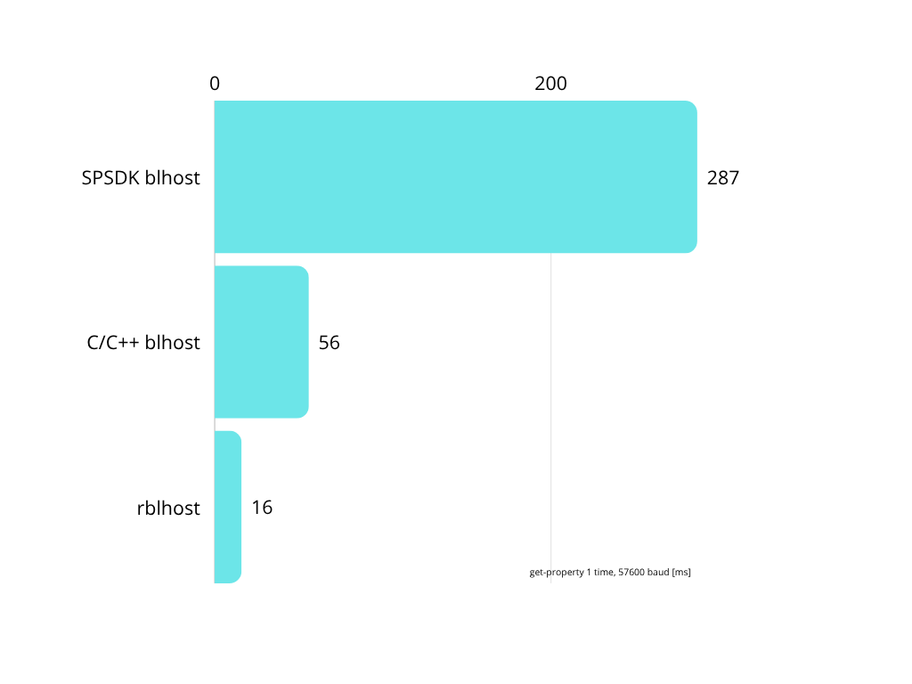

# Rblhost

<p align="center">
  
</p>


This is a concept implementation of the blhost tool in Rust programming language. It includes `McuBoot` implementation, similar to the one in `spsdk`, together with `spsdk`-like Python bindings using `pyo3` crate.

## Features

- UART communication with configurable baudrate and timeout
- I2C communication with configurable slave address
- USB-HID communication with configurable VID/PID, and selection of one specific device by
  OS path, serial number or USB topology (port) path when several identical boards are connected
- Command-line interface compatible with the original blhost tool
- Batch command files executed sequentially in one process and one device session
- Python bindings for integration with other tools
- C/C++ bindings (UART, I2C and USB-HID, see [MBoot C Bindings](#mboot-c-bindings))

## Documentation

- **API Documentation**: [docs.rs/rblhost](https://docs.rs/rblhost/latest/mboot/)
- **Examples**: See the [examples folder](examples/) for usage examples

## Changelog

### Version 0.3.0

- Add `flash-image --base-offset` to relocate all image segments.
- `flash-image` accepts Android SPARSE images (as exported by `nxpimage`), writing RAW and
  FILL chunks and skipping DONT_CARE gaps, like blhost.
- Add the `generate-key-blob` command.
- Match blhost's `-h/--use-hexdump` option and lowercase memory-read bytes.
- Added `batch COMMAND_FILE` with a shared device session, quoted arguments, comments,
  and fail-fast error reporting.
- Added `efuse-read-once` and `efuse-program-once` commands (CLI, Rust, Python and C API),
  compatible with blhost's argument order, hex `DATA` parsing and `lock` option.
- **Breaking:** `flash-image` CLI command now prints its final result using the standard
  `Response status = N (0xN) <Text>` pattern, matching every other `rblhost`/`blhost` command,
  instead of a custom `"Flash image operation completed successfully"` line on success (and a
  non-standard early-exit on failure). Scripts that pattern-matched on the old custom text must
  be updated to match the standard `Response status` line instead; the per-segment load/erase/
  write progress messages (printed unless `--silent` is set) are unchanged.
- **Breaking:** `flash-program-once` CLI positional argument order changed from
  `INDEX DATA COUNT [--verify]` to `INDEX COUNT DATA [--verify]`, matching blhost's
  `INDEX BYTE_COUNT DATA [ENDIANNESS]` convention. Scripts invoking the old order (e.g.
  `flash-program-once 0x60 0x12 4`) must be updated; the new `count` argument is now required
  and restricted to `4` or `8` to prevent silent misinterpretation of stale invocations.
- **Breaking:** `flash-program-once`/`flash-read-once` now correctly support 8-byte (`count=8`)
  OTP values end-to-end instead of silently truncating to 32 bits:
  - Rust: `McuBoot::flash_program_once`'s `data` parameter changed from `u32` to `u64`;
    `McuBoot::flash_read_once` continues to return `Box<[u8]>` with the full `count`-byte payload
    (no change from the previous 8-byte read fix).
  - Python: `flash_read_once` now returns `Optional[bytes]` instead of `Optional[list[int]]`,
    matching SPSDK's `McuBoot.flash_read_once` signature; `flash_program_once`'s `data` parameter
    now accepts values up to 64 bits.
  - C API: `mboot_flash_program_once`'s `data` parameter changed from `uint32_t` to `uint64_t`.
- Fixed undefined behavior in `mboot_free_flash_read_once_response`: the `bytes` buffer is now
  deallocated as the `Box<[u8]>` slice it was actually allocated as, instead of being passed
  through the generic single-element `free_box_data::<u8>` helper.
- `mboot_flash_read_once` no longer fabricates a fake 1-byte buffer for empty payloads; it now
  reports `bytes_len = 0` with a null `bytes` pointer.

### Version 0.2.0

- Added support for `flash-image` command with S-record format parsing
- Implemented S-record file format support in image parser
- Fixed stub files for Python bindings
  
## Performance Benchmark

The Rust implementation offers performance improvements compared to both the Python SPSDK implementation and the original C/C++ blhost tool.

<p align="center">
  
</p>

*Benchmark performed on MacBook Air M2 comparing rblhost with SPSDK blhost and C/C++ blhost 2.6.7. Benchmark measures get-property 1 command execution time with MCXN236 board and 57600 baud rate. Resulting time is in miliseconds.*

Key performance highlights:
- Faster startup time compared to both Python and C++ implementations
- Improved command execution speed
- Native performance with the convenience of Python bindings

### UART and USB-HID Benchmark (LPC55S69)

Additional benchmark comparing `rblhost` against the original C/C++ `blhost` (2.6.7) and the
SPSDK Python `blhost` (3.13.0.dev73), run on an LPC55S69 board, 5 repetitions per operation.
`flash-image` erases and writes a 32 KB S-record image.

**UART (57600 baud):**

| Operation       | C-blhost (s) | rblhost (s) | SPSDK-blhost (s) | rblhost vs C-blhost | rblhost vs SPSDK |
|-----------------|:------------:|:-----------:|:----------------:|:--------------------:|:-----------------:|
| get-property    | 0.20         | **0.09**    | 1.02              | 55.0% faster          | **91.2% faster**  |
| flash-image     | 6.45         | **6.02**    | 7.05              | 6.7% faster           | **14.6% faster**  |
| flash-erase-all | 0.20         | **0.10**    | 0.99              | 50.0% faster          | **89.9% faster**  |

**USB-HID:**

| Operation       | C-blhost (s) | rblhost (s) | SPSDK-blhost (s) | rblhost vs C-blhost | rblhost vs SPSDK |
|-----------------|:------------:|:-----------:|:----------------:|:--------------------:|:-----------------:|
| get-property    | 0.27         | **0.12**    | 1.15              | 55.6% faster          | **89.6% faster**  |
| flash-image     | 0.59         | **0.49**    | 1.56              | 16.9% faster          | **68.6% faster**  |
| flash-erase-all | 0.23         | **0.14**    | 1.13              | 39.1% faster          | **87.6% faster**  |

"rblhost vs X" is computed as `(X_time - rblhost_time) / X_time * 100`. SPSDK's Python
startup overhead (~1s per invocation) dominates the small/fast operations (`get-property`,
`flash-erase-all`), while `flash-image` over UART is largely bound by the 57600 baud link
speed itself, which is why the relative gap narrows there compared to USB-HID.


## Batch commands

Run a command file using a single RBLHOST process and communication session:

```text
rblhost --port COM3,57600 batch commands.txt
rblhost --usb 0x1FC9,0x0021 batch commands.txt
```

For example, `commands.txt` can contain:

```text
# One command per line, without the rblhost executable or global options.
get-property 1
get-property 24 # target version
read-memory 0 256 "memory dump.bin"
```

Blank lines and `#` comments are ignored. Arguments support shell-style single/double
quotes and backslash escaping; a quoted `#` is literal. On Windows, single-quote paths
containing backslashes (e.g. `'C:\images\firmware.bin'`). Relative file paths are resolved
against the current working directory, not the command file's directory. Command
arguments use the same parsers as standalone commands, including subcommands and
command-specific options.

Specify transport, timeout, verbosity and other global options before `batch`; they apply
to the entire batch. Nested `batch` and `list-usb` commands are not supported in a batch.
Commands run as each line is parsed. On the first invalid line, communication error,
file error or unsuccessful command status (including OTP verification failure), execution
stops with a nonzero exit code and the command file, 1-based line number and command name
on stderr. Earlier commands are not rolled back. Normal command output is unchanged.

The connection is opened once and released when the batch finishes or fails. RBLHOST
does not launch subprocesses, re-enter the top-level CLI or reconnect between commands.
Commands that reset the target, start an application or otherwise leave the bootloader
(such as `reset`, `execute` or some SB files) should be last. There is no automatic
reconnection after them.

### Comparing batch and separate invocations

Build the release CLI, put a target in serial bootloader mode, and run this PowerShell
example with its port. It measures the same 100 non-destructive queries in both modes,
including process startup and connection initialization. All child exit codes are checked.
Repeat the measurement to account for host/device timing variation.

```powershell
$exe = (Resolve-Path .\target\release\rblhost.exe).Path
$deviceArgs = @('--port', 'COM3,57600')
$count = 100
$batchFile = [System.IO.Path]::GetTempFileName()
try {
    Set-Content -LiteralPath $batchFile -Value (@('get-property 1') * $count) -Encoding ascii
    $separate = Measure-Command {
        for ($i = 0; $i -lt $count; $i++) {
            & $exe @deviceArgs --silent get-property 1 | Out-Null
            if ($LASTEXITCODE -ne 0) { throw "Standalone command $i failed" }
        }
    }
    $batch = Measure-Command {
        & $exe @deviceArgs --silent batch $batchFile | Out-Null
        if ($LASTEXITCODE -ne 0) { throw 'Batch failed' }
    }
    [pscustomobject]@{
        Commands = $count
        SeparateMilliseconds = $separate.TotalMilliseconds
        BatchMilliseconds = $batch.TotalMilliseconds
        Speedup = $separate.TotalMilliseconds / $batch.TotalMilliseconds
    }
} finally {
    Remove-Item -LiteralPath $batchFile
}
```

The hardware-free unit tests separately verify that multiple commands share one session
and that errors prevent subsequent commands and release the transport. Actual timing
depends on the host, transport and target; no fixed speedup is guaranteed.

## Installation

### Prerequisites

- Rust toolchain
- For Python bindings: Python 3.8+ with development headers
- libudev-dev package (for Linux)

### Prebuilt Executables

Prebuilt `rblhost` executables are attached to each [GitHub release](https://github.com/nxp-mcuxpresso/rblhost/releases):

- `rblhost-linux-x86_64`
- `rblhost-windows-x86_64.exe`
- `rblhost-macos-x86_64` (Intel)
- `rblhost-macos-arm64` (Apple Silicon)

Checksums are provided in `SHA256SUMS.txt`. On Linux and macOS, make the downloaded file executable with `chmod +x`.

The Linux executable requires glibc 2.35 or newer (e.g. Ubuntu 22.04+, Debian 12+, RHEL 10+) and `libudev`.

The macOS executables are not notarized. If macOS blocks a downloaded executable, remove the quarantine attribute:
```bash
xattr -d com.apple.quarantine rblhost-macos-arm64
```

### Building from Source

Clone the repository and cd into it:
```bash
git clone https://github.com/nxp-mcuxpresso/rblhost
cd rblhost
```

Refer to sections below to build bindings or the CLI tool.

#### Building CLI tool

Build the CLI tool:
```bash
cargo build --release
```

The binary will be available at `target/release/rblhost`. For example usage of the library, look in [examples folder](examples/).

#### Building Python bindings

1. Create and activate a virtual environment.
2. Build rblhost with Python bindings
   ```bash
   cargo build --release --features python
   ```
3. Install the Python bindings into the virtual environment
   - Normal installation
     ```bash
     pip install .
     ```
   - Development installation:
     ```bash
     pip install -e .
     ```

   The distributed package name is `pymboot-rs` (as shown by `pip show`/`pip list`),
   but the native extension module itself is still named `pymboot`, so your code must
   import it as:
   ```python
   from pymboot import McuBoot, PropertyTag
   ```
   (see [examples/python](examples/python) - this matches what the example scripts do).
   `import pymboot_rs` will **not** work; that name only exists as a `.pyi`
   type-stub/`py.typed` marker package for static type checkers, with no importable code.

For examples on how to use Python bindings, look into [examples folder](examples/python).

#### Building C bindings

**Note: Compiling together `python` and `c_api` features/bindings may result in malfunctioning libraries.**

**Prerequisites:**
- Rust toolchain (rustc, cargo)
- C compiler (gcc, clang)
- For Linux: libudev-dev package
- For macOS: Xcode command line tools

1. Run the following to build C bindings:
   ```bash
   cargo build --release --features c_api
   ```
2. This build process will:
   1. Compile the Rust library
   2. Generate C header files (compatible with C++) using cbindgen
   3. Create the shared library
3. Output files are:
   - Library:
     - Linux: `target/release/libmboot.so`
     - macOS: `target/release/libmboot.dylib`
     - Windows: `target/release/mboot.dll` (plus `mboot.dll.lib` import library)
   - Header file: `include/mboot.h`

**ABI/API compatibility:**
- The C API uses a stable, `#[repr(C)]` plain-C ABI (functions, structs, and enums declared in `src/c_api.rs`, mirrored into `include/mboot.h` by `cbindgen`). There is no versioned/stable ABI guarantee across `rblhost` releases yet — rebuild against the matching `include/mboot.h` for each release you consume.
- Built and tested with the Rust toolchain version pinned in `rust-version` in `Cargo.toml` (currently 1.88); any later stable toolchain is expected to work.
- CI (see [pipeline/](pipeline/)) builds and archives the C library + header for each supported OS platform (Linux, macOS, Windows) on every build, and verifies each produced library is loadable via `ctypes.CDLL(...)` before archiving.

For more information about the bindings, refer to [C Bindings](#mboot-c-bindings) section. For examples on how to use C bindings and an example `CMakeLists.txt` file, look into [examples folder](examples/c).

#### Building C# (.NET) bindings

**Note: Compiling together `python` and `csharp` features/bindings may result in malfunctioning libraries** (same underlying `cdylib`/`pyo3` conflict as `python`+`c_api`, see note above).

**Prerequisites:**
- Rust toolchain (rustc, cargo)
- C compiler (gcc, clang) - required transitively, since `csharp` enables `c_api`
- .NET SDK (to build/run the generated C# bindings and examples)
- For Linux: libudev-dev package
- For macOS: Xcode command line tools

1. Run the following to build C# bindings:
   ```bash
   cargo build --release --features csharp
   ```
2. This build process will:
   1. Compile the Rust library
   2. Generate the C header (via `cbindgen`, same as the `c_api` feature)
   3. Generate a C# `NativeMethods.g.cs` file (compatible with .NET P/Invoke) using [csbindgen](https://github.com/Cysharp/csbindgen)
   4. Create the shared library
3. Output files are:
   - Library:
     - Linux: `target/release/libmboot.so`
     - macOS: `target/release/libmboot.dylib`
     - Windows: `target/release/mboot.dll` (plus `mboot.dll.lib` import library)
   - C# bindings: `bindings/csharp/NativeMethods.g.cs` (declares `RblHost.NativeMethods`, matching response structs, and the `RblHost.CProtocol` enum)

`mboot_create` returns an opaque pointer (`void*`); wrap it in `IntPtr` on the C# side to avoid passing raw pointers around outside of `unsafe` blocks - see [examples/csharp](examples/csharp) for a worked example using `mboot_create`/`mboot_get_property`/`mboot_destroy`.

For more information about the underlying API, refer to [C Bindings](#mboot-c-bindings) section (the same functions, structs, and error codes apply; only the calling convention differs). For examples on how to use the C# bindings, look into [examples folder](examples/csharp).

### System-specific Requirements

#### Linux
- For UART: No additional requirements
- For I2C: The i2c-dev kernel module must be loaded
  ```bash
  sudo modprobe i2c-dev
  ```
- For USB-HID: Regular (non-root) users typically do not have permission to open HID
  devices directly via `hidapi`. Add a udev rule granting access to the target device's
  VID/PID, for example `/etc/udev/rules.d/99-rblhost-usb.rules`:
  ```
  SUBSYSTEM=="hidraw", ATTRS{idVendor}=="1fc9", TAG+="uaccess"
  ```
  (replace `1fc9` with the vendor ID of your device), then reload the rules:
  ```bash
  sudo udevadm control --reload-rules
  sudo udevadm trigger
  ```
  `TAG+="uaccess"` grants access to the currently logged-in local user via `systemd-logind`
  (no reboot/relogin needed on most modern distros) without opening the device up to every
  user on the system. If `uaccess` isn't available on your distro, use a dedicated group
  instead, e.g. `SUBSYSTEM=="hidraw", ATTRS{idVendor}=="1fc9", GROUP="plugdev", MODE="0660"`,
  and add your user to that group (`sudo usermod -aG plugdev $USER`, then log out/in).
  Avoid `MODE="0666"`, which grants every local user (and process) read/write access to the
  device. Alternatively, run `rblhost` as root.

#### Windows
- For UART: No additional requirements
- For USB-HID: No additional requirements (HID access is unprivileged on Windows)
- I2C communication is not supported on Windows

#### macOS
- For UART: No additional requirements
- For USB-HID: No additional requirements
- I2C communication is not supported on macOS


## CLI Usage

### Basic Command Structure

```
rblhost [OPTIONS] -- COMMAND [ARGS]...
```

### Communication Options

#### UART Connection

```
rblhost -p <port>[,<baudrate>] [OPTIONS] -- COMMAND [ARGS]...
```

- `<port>`: Serial port name (e.g., COM3, /dev/ttyUSB0)
- `<baudrate>`: Optional baudrate (default: 57600)

Example:
```
rblhost -p COM3,115200 -- reset
```

#### I2C Connection

**Basic information:**
1. Uses the Linux I2C device interface (`/dev/i2c-X`)
2. Supports specifying a slave address or uses the default (0x10)
3. Follows the same packet protocol as UART communication
4. Requires the i2c-dev kernel module to be loaded on Linux systems (refer to [System-specific Requirements](#system-specific-requirements))

```
rblhost --i2c <device>:<slave_address> [OPTIONS] -- COMMAND [ARGS]...
```

- `<device>`: I2C device path in `/dev/i2c-X` format, where `X` is the I2C bus number
- `<slave_address>`: Optional slave address in hex format (e.g., `0x3A`), default is `0x10`

Example:
```
rblhost --i2c /dev/i2c-1:0x3A -- reset
```

#### USB-HID Connection

```
rblhost -u <vid[,pid[,selector]]> [OPTIONS] -- COMMAND [ARGS]...
rblhost -u <selector> [OPTIONS] -- COMMAND [ARGS]...
```

- `<vid,pid>`: USB Vendor ID and Product ID in hex or decimal format, separated by a comma
  or colon (e.g., `0x1FC9,0x0135` or `0x1FC9:0x0135`). A single value is also accepted and is
  interpreted as VID only, matching any device with that vendor ID (PID defaults to `0`,
  i.e. "any").
- `<selector>`: picks one device when several share the same VID/PID (e.g. identical boards
  for parallel programming). It matches the device's OS path (exactly, or else as a
  substring), its exact serial number, or its exact USB topology path, all
  case-insensitively. It can also be used on its own, without a VID/PID prefix, if it is
  unique. If the selector matches more than one device, rblhost refuses to guess and lists
  the candidates.
- **USB topology path** (Linux and macOS): the physical port chain of the device,
  `<bus>-<port>[.<port>]*`, e.g. `1-1.4.3`. Unlike the OS path (`/dev/hidrawN` on Linux,
  `DevSrvsID:<id>` on macOS), it stays the same across reset, reconnect and the ROM ->
  flashloader re-enumeration, as long as the board stays on the same hub port, so prefer it
  for scripts. On Windows the OS path is already stable and no topology path is reported.
- `rblhost list-usb` lists connected NXP USB-HID devices with their path, topology path,
  serial number and ready-to-use `-u` arguments (`list-usb --all` lists all HID devices).
- Requires the `hidapi` crate's runtime dependencies to be available; see
  [System-specific Requirements](#system-specific-requirements) for Linux udev/HID
  permission setup.

Examples:
```
rblhost -u 0x1FC9,0x0135 -- get-property 1
rblhost list-usb
rblhost -u 0x1FC9,0x0135,1-1.4.3 -- get-property 1
rblhost -u ABCD1234 -- get-property 1
```

### Common Options

- `-t, --timeout <MILLISECONDS>`: Serial read timeout in milliseconds (default: 5000)
- `-s, --silent`: Suppress status response and response words
- `-v, --verbose`: Increase verbosity level (can be used multiple times)

Example with timeout:
```
rblhost -p COM3 -t 10000 -- flash-erase-all
```

### Available Commands

- `batch`: Executes a command file in one device session; see [Batch commands](#batch-commands)
- `get-property`: Queries various bootloader properties and settings
- `reset`: Reset the device
- `execute`: Jumps to code at the provided address
- `call`: Invokes code at an address, passing an argument to it
- `flash-erase-all`: Perform an erase of the entire flash memory
- `fill-memory`: Fills the memory with a pattern
- `read-memory`: Reads the memory and writes it to a file or stdout
- `set-property`: Changes properties and options in the bootloader
- `configure-memory`: Sets a config at internal memory to memory with ID
- `flash-erase-all-unsecure`: Erase Complete Flash and Unlock
- `flash-erase-region`: Erases one or more sectors of the flash memory
- `write-memory`: Write memory from a file or CLI
- `fuse-program`: Program fuse
- `fuse-read`: Reads the fuse and writes it to the file or stdout
- `receive-sb-file`: Receives a file in a Secure Binary (SB) format
- `flash-read-once`: Read from MCU flash program once region (eFuse/OTP)
- `efuse-read-once`: Returns the contents of a specific efuse word
- `efuse-program-once`: Writes data to a specific efuse word (blhost-compatible, see
  [State of work](#state-of-work))
- `flash-program-once`: Write into MCU program once region (eFuse/OTP)
- `trust-provisioning`: Group of subcommands related to trust provisioning
- `key-provisioning`: Group of subcommands related to key provisioning
- `load-image`: Sends a boot image file to the device
- `flash-image`: Parses an S-record, Intel HEX, Android SPARSE or binary image file and writes its segments to flash
  (optionally erasing target regions first); `--base-offset` can relocate all segments. Like all
  other commands, the final result is printed using the standard
  `Response status = N (0xN) <Text>` pattern.
- `generate-key-blob`: Wraps a DEK using the selected BKEK and writes the key blob to a file
- `list-usb`: Lists connected USB-HID devices (VID/PID, OS path, serial number), see
  [USB-HID Connection](#usb-hid-connection)

The `read-memory`, `fuse-read`, and `key-provisioning read_key_store` commands accept
`-h/--use-hexdump`, matching blhost. Standard memory-read output uses lowercase hex bytes.

Use `rblhost <COMMAND> --help` for the arguments of a specific command.

Example of reading and programming an efuse word (as with blhost, `DATA` is hexadecimal):
```
rblhost -p COM3 -- efuse-read-once 0x60
rblhost -p COM3 -- efuse-program-once 0x60 12345678 --verify
rblhost -p COM3 -- efuse-program-once 0x60 12345678 lock
```

## MBoot C Bindings

The MCU Boot library provides a C API that allows C/C++ applications to communicate with MCU bootloaders. The API provides functions for:

- Connecting to MCU bootloaders over UART, I2C, or USB-HID
- Reading and writing memory
- Getting device properties
- Executing commands on the device

For USB-HID, pass `MBOOT_C_PROTOCOL_USB` to `mboot_create` with the same identifier format as the
`-u/--usb` CLI option (see [USB-HID Connection](#usb-hid-connection)), e.g.
`"0x1FC9,0x0135"` or `"0x1FC9,0x0135,1-1.4.3"`; see `examples/c/get_property_usb.c`.

### Including the Library

1. Include the header file in your C code:
   ```c
   #include "mboot.h"
   ```

2. Compile your C program with the library:
   ```bash
   # Linux/macOS
   gcc -o my_program my_program.c -L./target/release -lmboot -Wl,-rpath,./target/release
   
   # Windows
   gcc -o my_program.exe my_program.c -L./target/release -lmboot
   ```
   You can also use cmake example in [examples](examples/c/CMakeLists.txt).

Look into the generated header to see all currently available functions.

### Error Handling

The API functions return integer status codes:

- `0`: Success
- `-1`: Invalid parameters (null pointers)
- `-2`: Invalid property tag
- `-3`: Communication error
- `-4`: Invalid key type

All of these errors are specified as macros in the generated header. It's also possible to use `mbot_get_status_text` function to get a text description of the error during runtime.

### Memory Management

All functions containing Allocations section in their documentation allocate data on heap, which must be later freed.

### Thread Safety

The MCU Boot C API is not thread-safe. Do not use the same `MBOOT_CMcuBoot` instance from multiple threads simultaneously.

### Troubleshooting

#### Library Not Found

If you get a "library not found" error when running your program:

- **Linux**: Set the `LD_LIBRARY_PATH` environment variable:
  ```bash
  export LD_LIBRARY_PATH=$LD_LIBRARY_PATH:./target/release
  ```

- **macOS**: Set the `DYLD_LIBRARY_PATH` environment variable:
  ```bash
  export DYLD_LIBRARY_PATH=$DYLD_LIBRARY_PATH:./target/release
  ```

- **Windows**: Add the library directory to your PATH or copy the DLL to the same directory as your executable.

#### Linking Errors

If you get undefined symbol errors when linking:

1. Make sure you're using the correct library name (`-lmboot`)
2. Check that the library path is correct (`-L./target/release`)
3. Verify that the library was built successfully
4. "Undefined reference to Py*" -- Build the library with only the `c_api` feature, like shown here:
   ```bash
   cargo build -rF c_api
   ```


## License

This project is licensed under the BSD 3-Clause License - see the [LICENSE](LICENSE) file for details.

## Missing and unimplemented features

- [ ] Implement all of `blhost` and `McuBoot` commands
- [ ] Add doc comments to **everything**
      This could be enforced by using [lints in rustdoc](https://doc.rust-lang.org/rustdoc/lints.html).
- [ ] Implement missing python bindings
- [ ] Address all TODO and FIXME comments
- [ ] Add different texts for different board families
- [ ] Refactor and optimize the code

# State of work

This table compares the commands available in rblhost (Rust implementation) with the original blhost (C implementation), and indicates which commands are supported in the Python bindings.

`batch` is a CLI-only convenience command, analogous to SPSDK's Python blhost batch mode;
it is not a bootloader protocol command or a new Python/C binding API.

| Command                  | rblhost | blhost | Python Bindings | C Bindings |
|--------------------------|:-------:|:------:|:---------------:|:----------:|
| reset                    | ✅      | ✅     | ✅              | ✅         |
| get-property             | ✅      | ✅     | ✅              | ✅         |
| set-property             | ✅      | ✅     | ✅              | ✅         |
| flash-erase-region       | ✅      | ✅     | ✅              | ✅         |
| flash-erase-all          | ✅      | ✅     | ✅              | ✅         |
| flash-erase-all-unsecure | ✅      | ✅     | ✅              | ✅         |
| read-memory              | ✅      | ✅     | ✅              | ✅         |
| write-memory             | ✅      | ✅     | ✅              | ✅         |
| fill-memory              | ✅      | ✅     | ✅              | ✅         |
| receive-sb-file          | ✅      | ✅     | ✅              | ✅         |
| execute                  | ✅      | ✅     | ✅              | ✅         |
| call                     | ✅      | ✅     | ✅              | ✅         |
| flash-security-disable   | ❌      | ✅     | ❌              | ❌         |
| flash-program-once       | ✅      | ✅     | ✅              | ✅         |
| flash-read-once          | ✅      | ✅     | ✅              | ✅         |
| efuse-program-once       | ✅¹     | ✅     | ✅              | ✅         |
| efuse-read-once          | ✅¹     | ✅     | ✅              | ✅         |
| flash-read-resource      | ❌      | ✅     | ❌              | ❌         |
| configure-memory         | ✅      | ✅     | ✅              | ✅         |
| flash-image              | ✅      | ✅     | ❌              | ❌         |
| reliable-update          | ❌      | ✅     | ❌              | ❌         |
| generate-key-blob        | ❌      | ✅     | ❌              | ❌         |
| key-provisioning         | ✅      | ✅     | ✅              | ✅         |
| load-image               | ✅      | ✅     | ✅              | ✅         |
| program-aeskey           | ❌      | ✅     | ❌              | ❌         |
| fuse-program             | ✅      | ❌     | ✅              | ✅         |
| fuse-read                | ✅      | ❌     | ✅              | ✅         |
| trust-provisioning       | ✅      | ❌     | ✅              | ✅         |

**C# Bindings:** C# support (via the `csharp` feature, see [Building C# (.NET) bindings](#building-c-net-bindings))
generates P/Invoke wrappers directly over the same `mboot_*` C API functions, so its command
coverage is identical to the "C Bindings" column above - no separate column is needed.

¹ `efuse-read-once`/`efuse-program-once` are thin wrappers over `flash-read-once`/
`flash-program-once` with a fixed 4-byte count; they use the same wire command
(`CommandTag::FlashReadOnce` = `0x0F` / `CommandTag::FlashProgramOnce` = `0x0E`). They follow
blhost's argument conventions, so blhost scripts can be used as-is:
- `efuse-program-once ADDRESS DATA [nolock|lock] [--verify]` parses `DATA` as **hexadecimal**,
  with or without a `0x` prefix (e.g. `efuse-program-once 0x60 12` writes `0x12`), unlike
  `flash-program-once`, which parses `DATA` as decimal unless prefixed with `0x`.
- `lock` sets bit 24 of `ADDRESS` to request a permanent lock of the fuse word.
- `efuse-read-once ADDRESS` prints the status followed by `Response word 1 = 4` (byte count)
  and `Response word 2 = <value>`, matching blhost's output.

The Python bindings expose `efuse_read_once(index)` / `efuse_program_once(index, value, verify)`
(matching SPSDK's `McuBoot`), the C API exposes `mboot_efuse_read_once` /
`mboot_efuse_program_once`.
